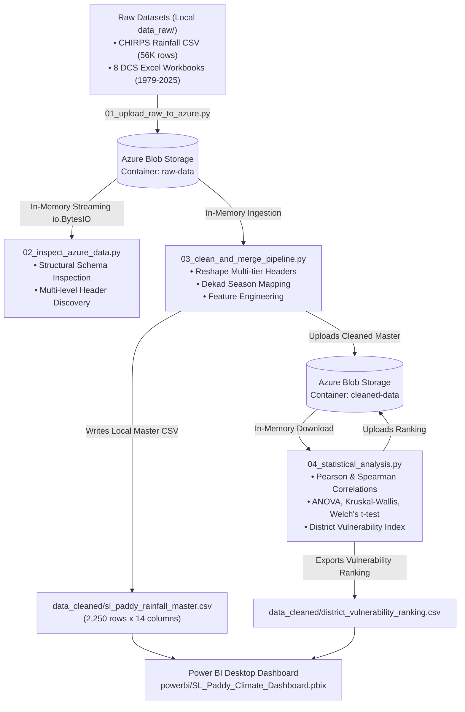
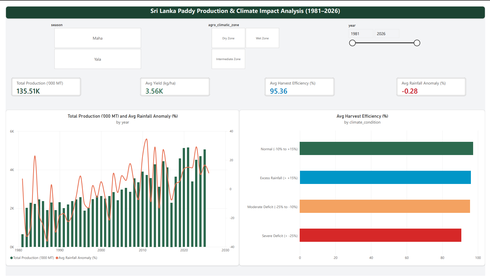
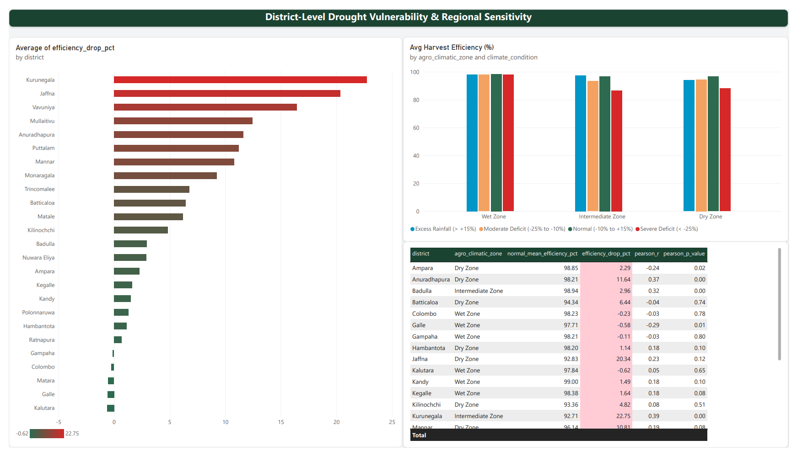

# Sri Lanka Paddy Cultivation & Climate Sensitivity Analysis (1981–2026)

[](https://www.python.org/)
[](https://azure.microsoft.com/)
[](https://powerbi.microsoft.com/)
[](LICENSE)

An end-to-end cloud data engineering and statistical modeling project analyzing **45+ years (1981–2026)** of seasonal rainfall anomalies and paddy crop dynamics across all **25 administrative districts** of Sri Lanka.

The project demonstrates cloud dataset ingestion, robust in-memory ETL transformation, domain feature engineering, parametric/non-parametric hypothesis testing (`scipy.stats`), district-level drought vulnerability indexing, and interactive Power BI executive reporting.

---

## 📌 Executive Summary

Sri Lanka's staple food security depends on paddy rice (*Oryza sativa*), cultivated across two distinct monsoon-driven agricultural seasons:
* **Maha Season**: North-East monsoon period (October to March).
* **Yala Season**: South-West monsoon period (April to September).

This repository integrates historical seasonal rainfall dekads (CHIRPS remote sensing) with 45+ years of official agricultural statistics from the Department of Census and Statistics (DCS).

### Key Empirical Findings:
1. **Drought Impact on Crop Survival**: During severe seasonal droughts ($< -25\%$ rainfall deficit), national harvest efficiency declines by **6.65 percentage points** ($p = 3.94 \times 10^{-16}$), and average crop yields drop by **255.0 kg/ha** ($p = 8.94 \times 10^{-6}$).
2. **Intermediate Zone Fragility**: Contrary to common assumptions, the **Intermediate Zone** (e.g., Kurunegala, Monaragala) exhibits the highest rainfall anomaly correlation ($r = +0.325, p < 10^{-9}$) and harvest failure risk due to reliance on minor irrigation tanks and rainfed farming.
3. **Wet Zone Inundation Penalty**: In the south-western **Wet Zone** (Colombo, Gampaha, Kalutara, Galle, Matara), rainfall deficits do not impair yields, whereas extreme excess rainfall ($> +15\%$) suppresses productivity ($r = -0.117$) through waterlogging, floods, and reduced solar radiation.
4. **Vulnerability Index**: **Kurunegala** ranks as Sri Lanka's most drought-vulnerable paddy district (experiencing a **22.75 pp** efficiency collapse during severe droughts), whereas the **Wet Zone** coastal belt exhibits near-complete climate resilience.

---

## 🏗️ System Architecture



---

## 📂 Repository Structure

```
SL_Paddy_Rainfall_Analysis/
├── assets/
│   ├── page1_executive_overview.png           # Power BI Page 1 Dashboard snapshot
│   └── page2_district_vulnerability.png       # Power BI Page 2 Dashboard snapshot
├── data_cleaned/
│   ├── district_vulnerability_ranking.csv     # 25-district climate vulnerability index
│   └── sl_paddy_rainfall_master.csv           # Harmonized master dataset (1981–2026)
├── data_raw/
│   ├── Average_Yeild-Maha_Season-1979-2025.xlsx
│   ├── Average_Yeild-Yala_Season-1979-2025.xlsx
│   ├── Harvested_Extent-Maha_Seasons-1979-2025.xlsx
│   ├── Harvested_Extent-Yala_Seasons-1979-2025.xlsx
│   ├── Production-Maha_Season-1979-2025.xlsx
│   ├── Production-Yala_Season-1979-2025.xlsx
│   ├── Sown_Extent-Maha_Seasons-1979-2025.xlsx
│   ├── Sown_Extent-Yala_Seasons-1979-2025.xlsx
│   └── sl_rainfall_raw.csv                    # Dekadal CHIRPS rainfall observations
├── powerbi/
│   └── SL_Paddy_Climate_Dashboard.pbix        # Interactive Power BI analytical report
├── scripts/
│   ├── 01_upload_raw_to_azure.py              # Cloud migration of raw files
│   ├── 02_inspect_azure_data.py               # In-memory blob inspection & validation
│   ├── 03_clean_and_merge_pipeline.py         # Production ETL & feature engineering pipeline
│   └── 04_statistical_analysis.py             # Hypothesis testing & vulnerability modeling
├── .env.example                               # Template for Azure storage connection string
├── .gitignore                                 # Git rules ignoring credentials and virtual env
├── README.md                                  # Comprehensive project documentation
└── requirements.txt                           # Pinned Python package dependencies
```

---

## 📊 Interactive Power BI Dashboard

The project includes a production-grade two-page Power BI report ([SL_Paddy_Climate_Dashboard.pbix](powerbi/SL_Paddy_Climate_Dashboard.pbix)) providing executive, temporal, and spatial decision support.

### Page 1: Executive Overview & Climate Sensitivity
A high-level cockpit tracking multi-decade national production growth, seasonal anomalies, and baseline climate resilience across Sri Lanka (1981–2026).



#### Visible Page 1 KPIs & Dashboard Visuals:
* **Interactive Slicers**: Multi-select filtering by **Season** (`Maha`, `Yala`), **Agro-Climatic Zone** (`Dry Zone`, `Intermediate Zone`, `Wet Zone`), and **Harvest Year** slider (`1981` to `2026`).
* **Executive KPI Cards**:
  * **Total Production ('000 MT)**: `135.51K` (aggregate national paddy output).
  * **Avg Yield (kg/ha)**: `3.56K` (mean productivity: 3,556 kg/ha).
  * **Avg Harvest Efficiency (%)**: `95.36%` (mean harvested-to-sown land ratio).
  * **Avg Rainfall Anomaly (%)**: `-0.28%` (near-zero multi-decade baseline balance).
* **Dual-Axis Temporal Chart**: *Total Production ('000 MT) and Avg Rainfall Anomaly (%) by year* — illustrates multi-decade production growth alongside annual monsoon rainfall fluctuations.
* **Climate Impact Bar Chart**: *Avg Harvest Efficiency (%) by climate_condition* — highlights the progressive drop in crop survival from **Normal (97.35%)** and **Excess Rainfall (95.99%)** down to **Severe Deficit (90.70%)**.

---

### Page 2: District-Level Drought Vulnerability & Regional Sensitivity
A granular comparative drill-down ranking all 25 districts and comparing agro-climatic zone behaviors under severe water stress.



#### Visible Page 2 Visuals & Analytical Components:
* **District Vulnerability Ranking Chart**: *Average of efficiency_drop_pct by district* — a diverging color-gradient bar chart (from `-0.62` to `22.75`) ranking districts from highest harvest loss (Kurunegala at `22.75 pp`, Jaffna at `20.34 pp`, Vavuniya at `16.42 pp`) to most resilient (Kalutara at `-0.62 pp`, Galle at `-0.58 pp`).
* **Regional Climate Sensitivity Clustered Chart**: *Avg Harvest Efficiency (%) by agro_climatic_zone and climate_condition* — reveals that while the **Wet Zone** remains virtually immune across all 4 climate categories (~98%), the **Intermediate Zone** and **Dry Zone** experience severe efficiency drops down to **86.51%** and **88.09%** respectively during severe droughts.
* **District Statistical Matrix**: Comprehensive cross-district table displaying `district`, `agro_climatic_zone`, `normal_mean_efficiency_pct`, `efficiency_drop_pct`, `pearson_r`, and `pearson_p_value`.

---

## 🔬 Statistical Hypothesis Testing & Modeling

### 1. Analysis of Variance across Climate Conditions
To test whether agricultural metrics differ across climate condition categories (`Severe Deficit`, `Moderate Deficit`, `Normal Baseline`, `Excess Rainfall`), we evaluated one-way ANOVA and the non-parametric Kruskal-Wallis test:

| Agricultural Metric | One-Way ANOVA ($F$-Statistic) | Kruskal-Wallis ($H$-Statistic) | Statistical Significance ($p$-Value) |
| :--- | :---: | :---: | :---: |
| **Harvest Efficiency (%)** | $F = 45.54$ | $H = 103.77$ | $p < 1.0 \times 10^{-20}$ (Reject $H_0$) |
| **Average Yield (kg/ha)** | $F = 16.76$ | $H = 37.25$ | $p < 1.0 \times 10^{-7}$ (Reject $H_0$) |

### 2. Welch's Two-Sample t-Test (Severe Deficit vs. Normal Baseline)
Quantifying the direct shock of severe rainfall deficits compared to baseline conditions:
* **Harvest Efficiency**: $t = -8.45$ ($p = 3.94 \times 10^{-16}$)  
  * Normal Mean: **97.35%** vs. Severe Deficit Mean: **90.70%** (Absolute loss: **6.65 percentage points**).
* **Average Yield**: $t = -4.47$ ($p = 8.94 \times 10^{-6}$)  
  * Normal Mean: **3,583.9 kg/ha** vs. Severe Deficit Mean: **3,328.9 kg/ha** (Yield loss: **255.0 kg/ha**).

### 3. District Vulnerability Ranking Highlights
Districts are ranked by the absolute harvest efficiency loss experienced during severe deficit periods:

| Rank | District | Province | Agro-Climatic Zone | Normal Eff. | Severe Deficit Eff. | Efficiency Drop | Vulnerability Tier |
| :---: | :--- | :--- | :--- | :---: | :---: | :---: | :--- |
| **1** | **Kurunegala** | North Western | Intermediate Zone | 92.71% | 69.96% | **-22.75 pp** | High Vulnerability |
| **2** | **Jaffna** | Northern | Dry Zone | 92.83% | 72.49% | **-20.34 pp** | High Vulnerability |
| **3** | **Vavuniya** | Northern | Dry Zone | 96.15% | 79.73% | **-16.42 pp** | High Vulnerability |
| **4** | **Mullaitivu** | Northern | Dry Zone | 95.77% | 83.33% | **-12.44 pp** | High Vulnerability |
| **5** | **Anuradhapura** | North Central | Dry Zone | 98.21% | 86.56% | **-11.64 pp** | High Vulnerability |
| ... | ... | ... | ... | ... | ... | ... | ... |
| **21** | **Gampaha** | Western | Wet Zone | 98.21% | 98.32% | **+0.11 pp** | Climate Resilient |
| **22** | **Colombo** | Western | Wet Zone | 98.23% | 98.46% | **+0.23 pp** | Climate Resilient |
| **23** | **Matara** | Southern | Wet Zone | 98.23% | 98.75% | **+0.53 pp** | Climate Resilient |
| **24** | **Galle** | Southern | Wet Zone | 97.71% | 98.29% | **+0.58 pp** | Climate Resilient |
| **25** | **Kalutara** | Western | Wet Zone | 97.84% | 98.46% | **+0.62 pp** | Climate Resilient |

---

## 🚀 Setup & Execution Guide

### 1. Prerequisites & Environment Setup
Clone the repository and create an isolated Python virtual environment:
```bash
git clone https://github.com/<your-username>/SL_Paddy_Rainfall_Analysis.git
cd SL_Paddy_Rainfall_Analysis

# Create virtual environment
python -m venv .venv

# Activate virtual environment
# Windows:
.venv\Scripts\activate
# macOS/Linux:
source .venv/bin/activate

# Install dependencies
pip install -r requirements.txt
```

### 2. Configure Azure Storage Credentials
Copy `.env.example` to `.env` and set your Azure Storage connection string:
```bash
cp .env.example .env
```
Edit `.env`:
```ini
AZURE_STORAGE_CONNECTION_STRING="DefaultEndpointsProtocol=https;AccountName=<your_storage_account>;AccountKey=<your_account_key>;EndpointSuffix=core.windows.net"
```

### 3. Pipeline Execution Steps

#### Step 1: Upload Raw Datasets to Azure
Uploads all 9 raw Excel and CSV files from `data_raw/` to Azure Blob Storage (`raw-data` container):
```bash
python scripts/01_upload_raw_to_azure.py
```

#### Step 2: In-Memory Blob Inspection
Inspects column names, sheets, and multi-tier headers directly in Azure memory buffers:
```bash
python scripts/02_inspect_azure_data.py
```

#### Step 3: Run Master ETL & Feature Engineering Pipeline
Reads from Azure `raw-data`, unpivots and cleans DCS tables, aggregates dekadal rainfall by agricultural season, joins the datasets, generates domain features, saves `data_cleaned/sl_paddy_rainfall_master.csv`, and uploads to `cleaned-data`:
```bash
python scripts/03_clean_and_merge_pipeline.py
```

#### Step 4: Execute Statistical Modeling & Vulnerability Ranking
Downloads the master dataset from Azure `cleaned-data`, runs ANOVA, Kruskal-Wallis, and Welch's t-tests, produces `data_cleaned/district_vulnerability_ranking.csv`, and uploads results to Azure:
```bash
python scripts/04_statistical_analysis.py
```

#### Step 5: Power BI Visualization
Open [powerbi/SL_Paddy_Climate_Dashboard.pbix](powerbi/SL_Paddy_Climate_Dashboard.pbix) using Power BI Desktop to explore the interactive visual analytics.

---

## 🛠️ Technology Stack

| Layer | Tools & Libraries | Purpose |
| :--- | :--- | :--- |
| **Cloud Storage** | Azure Blob Storage SDK (`azure-storage-blob`) | Cloud data lake storing raw and harmonized assets |
| **Configuration** | `python-dotenv` | Secure environment variable and credential management |
| **Data Processing** | `pandas`, `numpy`, `openpyxl` | In-memory unpivoting, cleaning, and feature engineering |
| **Statistical Analysis** | `scipy.stats` | Parametric/non-parametric hypothesis testing & correlations |
| **Business Intelligence** | Microsoft Power BI Desktop | Interactive executive reporting and geospatial visualization |
| **Version Control** | Git & GitHub | Secure code management and CI-ready portfolio documentation |

---

## 📄 License
This project is open-source under the [MIT License](LICENSE).
